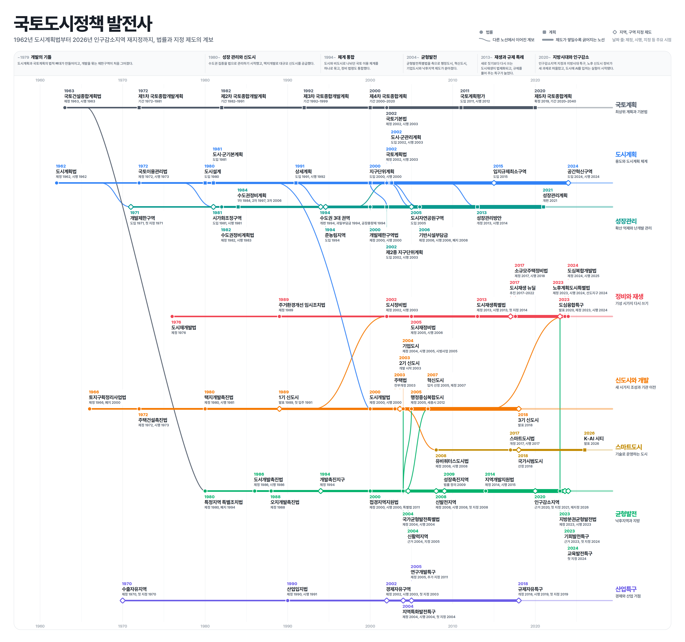

# 국토도시정책 발전사

1962년 도시계획법부터 2026년 인구감소지역 재지정까지, 한국 국토 및 도시정책의 법률과 지정 제도를 계보로 정리한 그림이다.

[PDF로 보기 (선명, 확대 가능)](https://handbell-h.github.io/tree/policy-history/policy-history.pdf)

## 구성

| 노선 | 다루는 내용 | 역 수 |
|---|---|---|
| 국토계획 | 최상위 계획과 기본법 | 8 |
| 도시계획 | 용도와 도시계획 체계 | 10 |
| 성장관리 | 확산 억제와 난개발 관리 | 12 |
| 정비와 재생 | 기성 시가지 다시 쓰기 | 10 |
| 신도시와 개발 | 새 시가지 조성과 기관 이전 | 11 |
| 스마트도시 | 기술로 운영하는 도시 | 4 |
| 균형발전 | 낙후지역과 지방 | 14 |
| 산업특구 | 경제와 산업 거점 | 6 |

역 75개, 날짜 141개, 계보선 68개로 이루어져 있다.

## 읽는 법

- 원(●)은 법률, 네모(■)는 계획, 마름모(◆)는 지역 및 구역 지정 제도이다.
- 역의 가로 위치는 근거 법령의 제정 또는 도입 연도이다.
- 이름표의 날짜 줄에는 제정, 시행, 첫 지정 등 주요 시점을 적었다.
- 노선 사이를 잇는 곡선은 다른 노선에서 이어진 계보이며, 출발한 노선의 색으로 그렸다.
- 노선은 제도가 쌓일수록 굵어진다.

## 데이터

`policy-history-dates.csv`에 모든 날짜를 한 줄씩 정리하였다.

| 열 | 내용 |
|---|---|
| 노선, 이름, 종류 | 역의 소속 노선과 이름, 법률, 계획, 지정 제도 구분 |
| 구분, 연도 | 제정, 시행, 첫 지정 등 날짜의 종류와 연도 |
| 상태 | 공식 자료 확인 여부 (현재 전체 확인) |
| 이어진 부모, 계보 성격 | 계보선의 출발 역과 관계 (법률 통합, 폐지 후 대체, 경과조치로 승계 등) |
| 근거 자료 | 날짜와 계보를 확인한 자료 (국가법령정보센터, 국가기록원, 국토교통부 등) |

## 검수

다음 여섯 가지를 확인하였다.

1. 구조: 끊긴 연결, 연도 역순, 이름 중복
2. 날짜 논리: 시행이나 첫 지정이 제정보다 앞서는지, 위치 연도와 날짜 줄의 일치
3. 계보와 근거: 모든 계보선의 성격과 근거 자료
4. 그림과 데이터 대조: 이름표와 데이터의 글자 단위 일치
5. 배치: 글자 겹침, 선 교차, 줄바꿈, 칸 넘침, 표식 겹침
6. 표현: 연도 형식, 예정 연도 표기, 시기 설명과 제도의 시기 일치

## 한계

- 계보선 가운데 다음 역으로 들어가는 선은 법률 승계가 아니라 정책 계열 또는 정책 묶음 관계이다: 2기 신도시, 3기 신도시, 경제자유구역, 교육발전특구, 기업도시, 도시재생특별법, 도시재정비법, 도심복합개발법, 도심융합특구, 행정중심복합도시, 혁신도시.
- 오지개발촉진법, 산업입지법, 연구개발특구는 다른 역과 이을 법률 근거를 찾지 못해 계보선이 없다.
- K-AI 시티는 2026년 9월 발표된 실행전략으로, 근거 법률(인공지능·스마트도시법)은 2027년 개편 예정이다.
- 도시·군기본계획과 도시·군관리계획은 현재 명칭으로 적었으며, 도입 당시 명칭은 각각 도시기본계획, 도시관리계획이다.
- 상세계획(1991)과 도시설계(1980)는 2000년 지구단위계획으로 통합되어 현재는 쓰이지 않는 제도이다.

## 파일

| 파일 | 용도 |
|---|---|
| `policy-history.pdf` | 원본 그림 (벡터, 확대용) |
| `policy-history.png` | 미리보기 및 공유용 이미지 (6120×5739) |
| `policy-history-dates.csv` | 날짜, 계보, 근거 자료 표 |
