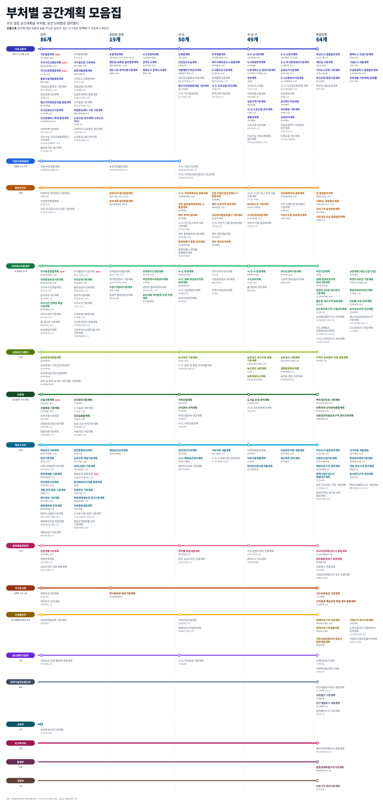
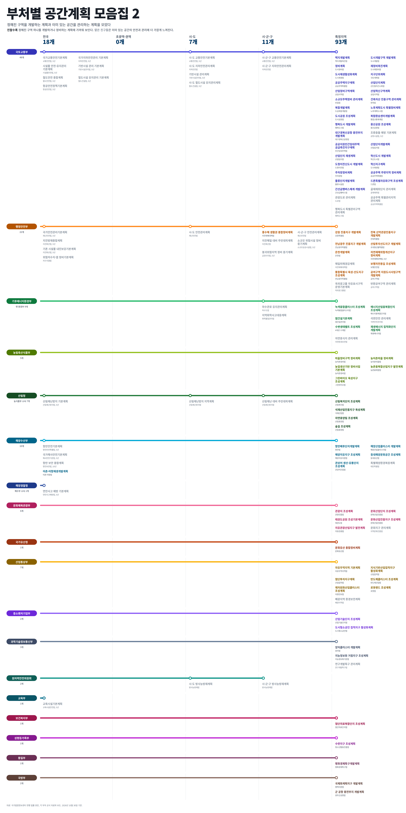

# 부처별 공간계획 모음집

현행 법률에 근거한 법정 공간계획을 소관부처별, 공간 단위별로 정리한 그림 두 장이다. 1편은 땅의 쓰임과 공간 정책을 다루는 계획 268개, 2편은 정해진 구역을 개발하는 계획과 이미 있는 공간을 관리하는 계획 129개를 담았다.

- [1편 PDF로 보기 (선명, 확대 가능)](https://handbell-h.github.io/tree/spatial-plan-collection/spatial-plan-collection-1.pdf)
- [2편 PDF로 보기 (선명, 확대 가능)](https://handbell-h.github.io/tree/spatial-plan-collection/spatial-plan-collection-2.pdf)

## 구성

| 그림 | 다루는 내용 | 계획 | 진한 글자 | 옅은 글자 | 기관 |
|---|---|---|---|---|---|
| 1편 | 땅의 쓰임, 시설 배치, 공간 정책 | 268 | 151 | 117 | 16 |
| 2편 | 구역 단위 개발, 기존 공간의 안전과 관리 | 129 | 81 | 48 | 18 |

| 공간 단위 | 1편 | 2편 |
|---|---|---|
| 전국 | 86 | 18 |
| 초광역·권역 | 19 | 0 |
| 시·도 | 50 | 7 |
| 시·군·구 | 49 | 11 |
| 특정지역 | 64 | 93 |

## 읽는 법

- 노선은 근거 법률의 소관부처이다. 국토교통부는 국토, 도시, 교통 계획을 한 노선으로 묶었다.
- 칸은 계획이 다루는 공간 단위이며, 대체로 수립 주체의 층위(국가, 시·도, 시·군·구)와 같다. 특정지역은 특정 구역이나 지구를 대상으로 하는 계획이다.
- 노선 위의 원(○)은 그 소관부처가 해당 공간 단위에 계획을 하나 이상 가진다는 표시이다.
- 계획 이름 아래에는 근거 법률 약칭과 수립 주기를 적었다. 주기는 조문에서 확인한 것만 적었다.
- 1편은 글자가 진할수록 공간에 대한 비중이 높을 것으로 보이고, 옅은 계획은 정책에 더 가깝다. 2편은 진할수록 정해진 구역 하나를 개발하거나 정비하는 계획에 가깝고, 옅은 계획은 이미 있는 공간의 안전과 관리에 가깝다.
- 빨간 "최상위"는 법령이나 소관부처가 해당 분야 최상위 계획이라고 밝힌 전국 계획이다.
- 한 칸에 계획이 다섯 개 이상이면 두 줄로 나누어 적었다.

## 방법

현행 법률 원문(legalize-kr 저장소의 국가법령정보센터 원문, 2026년 10월 29일 기준 법률 1,738건)에서 계획 조항을 세 차례 추출하였다.

1. 조문 제목: "…계획의 수립" 등이 들어간 조문에서 계획 조항 1,551개
2. 정의 조항: "(이하 …계획)" 정의에서 새 계획명 102개
3. 본문 수립 문장: "…계획을 수립하여야 한다" 문장에서 새 계획 67개

회차마다 새로 나온 계획 수가 줄어드는 것을 확인하였다. 추출한 조항은 소관부처별로 모두 검토하여 그림에 넣을 계획을 골랐다.

## 데이터

`spatial-plan-collection-data.csv`에 그림에 실린 계획 397개를 한 줄씩 정리하였다.

| 열 | 내용 |
|---|---|
| 편 | 1편, 2편 |
| 소관부처, 공간 단위, 계획명 | 노선, 칸, 계획 이름 |
| 근거 법률, 주기 | 법률 약칭과 법정 수립 주기(확인한 경우) |
| 글자, 성격 | 진함 또는 옅음, 공간형, 정책형, 사업·지구형, 관리형 |
| 최상위 | 최상위 계획 표시 여부 |

`spatial-plan-collection-clauses.csv`에는 추출한 계획 조항 1,551개 전체를 담았다.

| 열 | 내용 |
|---|---|
| 법률, 소관부처, 조문, 조문 제목, 계획명 | 조항 위치와 계획 이름 |
| 분류 | 그림 반영, 공간 후보, 하위 및 사업 단위, 비공간, 기타 |
| 주기 | 조문에서 읽은 수립 주기 |

## 검수

다음 네 가지를 확인하였다.

1. 재현율: 수작업으로 먼저 정리한 112개 가운데 111개를 자동 추출이 다시 찾았다.
2. 이름 대조: 그림의 계획명과 추출 결과를 이름 전체 일치로 대조하여 중복과 누락을 확인하였다.
3. 조문 확인: 추가한 계획의 수립 주체와 주기를 조문 원문으로 확인하였다.
4. 배치: 칸 넘침, 글자 겹침, 줄바꿈

## 한계

- 진함과 옅음은 조문 내용을 근거로 한 판단이며 법이 정한 구분이 아니다. 법조문만으로 구분해 보았으나, 공간 결정 항목이 수립 조항과 다른 조문이나 시행령에 있는 경우가 많아 깔끔한 기준이 나오지 않았다.
- 법률과 시행령만 대상으로 하였고 조례와 행정규칙은 포함하지 않았다.
- 2편의 구역 단위 개발 계획은 계획 종류로만 셌으며 개별 지구 수는 세지 않았다.
- 같은 법정계획을 여러 문서로 나누어 발표하는 경우 하나로 셌다. 예를 들어 도로건설·관리계획은 고속도로 건설계획, 국도·국지도 건설계획, 도로관리계획으로 나누어 발표된다.
- 소관부처는 법령 기준이며 정부조직은 2026년 10월 기준이다(기후에너지환경부, 산업통상부).
- 통합특별시 통합 공간계획처럼 2026년에 새로 생긴 법률의 계획은 아직 수립 전일 수 있다.

## 파일

| 파일 | 용도 |
|---|---|
| `spatial-plan-collection-1.pdf` | 1편 원본 그림 (벡터, 확대용) |
| `spatial-plan-collection-1.png` | 1편 미리보기 및 공유용 이미지 (4000×8410) |
| `spatial-plan-collection-2.pdf` | 2편 원본 그림 (벡터, 확대용) |
| `spatial-plan-collection-2.png` | 2편 미리보기 및 공유용 이미지 (4000×7999) |
| `spatial-plan-collection-data.csv` | 그림에 실린 계획 397개 |
| `spatial-plan-collection-clauses.csv` | 추출한 계획 조항 1,551개 |
