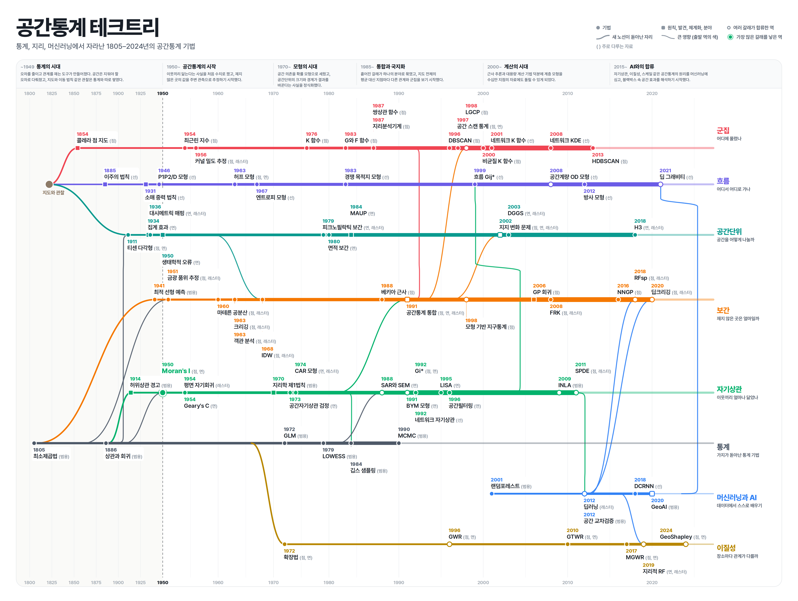

# 공간통계 테크트리

1805년 최소제곱법부터 2024년 GeoShapley까지, 공간통계 기법과 발견 80개가 어디서 갈라져 나와 어떻게 이어졌는지 정리한 그림이다.

[PDF로 보기](spatial-stats-techtree.pdf)

## 구성

공간통계는 세 뿌리에서 자랐다. 지도와 관찰에서 군집, 흐름, 공간단위 노선이 돋았고, 통계 노선에서 보간, 자기상관, 이질성 노선이 갈라졌으며, 2001년 이후 머신러닝과 AI가 합류하였다.

| 노선 | 노선이 묻는 질문 | 역 수 |
|---|---|---|
| 군집 | 어디에 몰렸나 | 14 |
| 흐름 | 어디서 어디로 가나 | 10 |
| 공간단위 | 공간을 어떻게 나눌까 | 10 |
| 보간 | 재지 않은 곳은 얼마일까 | 14 |
| 자기상관 | 이웃끼리 얼마나 닮았나 | 15 |
| 통계 | 가지가 돋아난 통계 기법 | 6 |
| 머신러닝과 AI | 데이터에서 스스로 배우기 | 5 |
| 이질성 | 장소마다 관계가 다를까 | 6 |

역 80개(기법 68개, 원칙, 발견, 체계화, 분야 12개)와 노선을 넘는 큰 영향 연결 20개(노선이 돋아나는 가지 3개 포함)로 이루어져 있다.

| 시기 | 이름 |
|---|---|
| ~1949 | 통계의 시대 |
| 1950–1969 | 공간통계의 시작 |
| 1970–1984 | 모형의 시대 |
| 1985–1999 | 통합과 국지화 |
| 2000–2014 | 계산의 시대 |
| 2015~ | AI와의 합류 |

## 읽는 법

- 원(●)은 기법, 네모(■)는 원칙, 발견, 체계화, 분야이다.
- 속이 빈 원은 여러 노선의 갈래가 합류한 역이다.
- 고리를 두른 큰 원은 가장 많은 갈래를 낳은 역(Moran's I, 후손 27곳, 6개 노선)이다.
- 이름 옆 괄호는 주로 다루는 자료(점, 선, 면, 래스터, 범용)이다.
- 노선 사이 곡선은 새 노선이 돋아난 자리이거나, 직계 자식이 3곳 이상인 역에서 다른 노선으로 뻗은 큰 영향이다. 큰 영향은 출발한 역의 색으로 그렸다.
- 노선은 역이 쌓일수록 굵어진다.
- 가로축은 균등하지 않다. 1950년 이전은 압축하고, 역이 몰린 1985년 이후는 넓혔다.

## 데이터

`spatial-stats-techtree-data.csv`에 역 80개를 노선과 연도 순으로 정리하였다.

| 열 | 내용 |
|---|---|
| 노선, 노선 질문 | 역이 속한 노선과 그 노선이 묻는 질문 |
| 연도, 이름, 정식 이름 | 첫 공개 연도와 그림의 표기, 정식 명칭 |
| 유형, 주로 다루는 자료 | 기법, 원칙, 발견, 체계화, 분야 구분과 자료 유형 |
| 인물, 설명, 알게 된 것 | 제안자, 한 줄 설명, 이 역으로 새로 알게 된 것 |
| 대표 논문 | 저자, 연도, 제목, 학술지 |
| 이어진 부모, 큰 영향으로 그린 연결 | 계보상 부모 역과 그중 그림에 곡선으로 그린 연결 |

## 검수

- 구조: 끊긴 연결, 연도 역순, 고립 역
- 배치: 글자 겹침, 선이 글자를 지나는 곳, 줄바꿈, 시기 설명 칸 넘침

## 한계

- 계보는 대표 인용 관계와 개념적 영향을 함께 반영하였다. 콜레라 점 지도에서 최근린 지수로 이어지는 선처럼 인용 관계가 아닌 서사적 연결도 일부 있다.
- 연도는 첫 공개 기준이다. 예를 들어 딥크리깅은 학술지 게재(2024)가 아니라 arXiv 공개(2020) 연도를 썼다.
- 대표 논문은 저자, 연도, 제목, 학술지만 적었다. 권호와 쪽수는 원문에서 확인해야 한다.
- 군집 노선은 점의 위치가 몰리는 점 군집을 다룬다. 값이 비슷한 지역끼리 모이는 핫스팟(LISA, Gi*)은 자기상관 노선에 있다.
- DBSCAN과 HDBSCAN은 데이터마이닝 기법이지만 공간 데이터 실무에서 비중이 커서 포함하였다.
- 지리학 제1법칙(1970)은 연표상 Moran's I(1950) 이후에 명명되었으므로 자기상관 노선의 1970년 자리에 두었다. 가까운 것이 더 닮는다는 생각 자체는 그 이전부터 있었다.

## 파일

| 파일 | 용도 |
|---|---|
| `spatial-stats-techtree.pdf` | 원본 그림 (벡터, 확대용) |
| `spatial-stats-techtree.png` | 미리보기 및 공유용 이미지 (6480×4882) |
| `spatial-stats-techtree-data.csv` | 역 80개의 연도, 유형, 자료, 설명, 대표 논문, 계보 |
